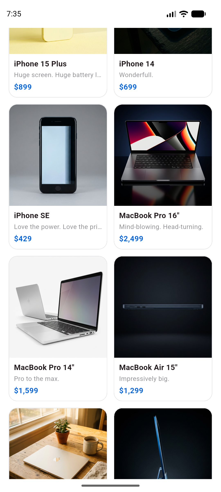
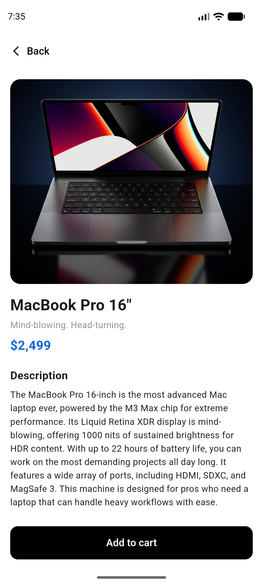
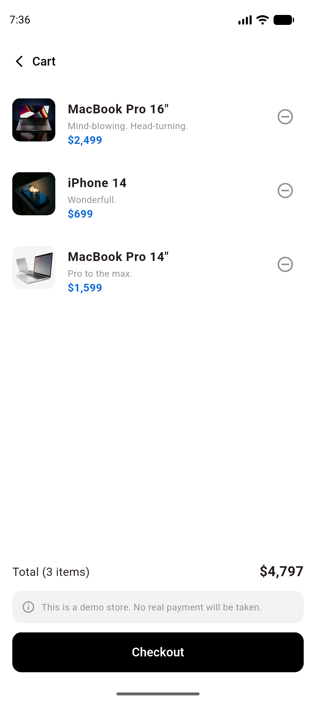
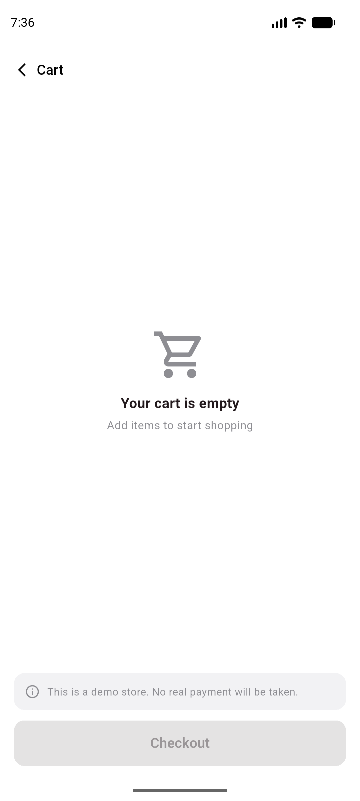

# Mini Katalog Uygulaması

Flutter ile geliştirilmiş, Android'de çalışan basit bir ürün katalog uygulaması.
"Flutter Günlük Eğitim" kapsamında hazırlanmış eğitim projesidir.

Uygulama üç ekrandan oluşur:

- **Discover (Ana sayfa / ürün listesi):** Arama kutusu, banner ve 2 sütunlu ürün grid'i. Sağ üstteki çanta ikonunda sepetteki ürün sayısı görünür.
- **Product Detail:** Ürün görseli, adı, fiyatı, açıklaması ve özellikleri. **Add to cart** ile ürün sepete eklenir.
- **Cart:** Sepetteki ürünler, toplam tutar, ürün çıkarma ve demo **Checkout**. Gerçek ödeme alınmaz.

## Kullanılan teknolojiler ve konular

- Flutter + Dart, yalnızca `material.dart` (ekstra paket yok)
- Named routes ve **Route Arguments** ile sayfalar arası veri taşıma
- `GridView.builder` ile kart tabanlı tasarım, `ListView.builder` ile sepet listesi
- `Product` model sınıfı, `fromJson` / `toJson`
- JSON verisinin asset'ten okunması (`rootBundle` + `jsonDecode`)
- Asset yönetimi: `assets/products.json` ve `assets/images/banner.png` (`Image.asset`)
- `ChangeNotifier` + `ListenableBuilder` ile basit sepet state yönetimi
- Ada göre anlık arama/filtreleme

## Kullanılan Flutter sürümü

```
Flutter 3.44.9 • channel stable
Dart 3.12.2
```

## Çalıştırma adımları

Gereksinimler: Flutter SDK, Android Studio (Android SDK + emülatör) veya USB hata ayıklaması açık bir Android cihaz.

```bash
git clone <repo-adresi>
cd <repo-klasoru>
flutter pub get
flutter run
```

Testleri ve kod analizini çalıştırmak için:

```bash
flutter analyze
flutter test
```

## Klasör yapısı

```
lib/
├─ main.dart                      # Uygulama girişi, tema ve route'lar
├─ app_routes.dart                # Route adları ('/', '/detail', '/cart')
├─ theme/app_theme.dart           # Renkler ve ThemeData
├─ models/product.dart            # Product modeli (fromJson / toJson)
├─ data/product_repository.dart   # assets/products.json okuma
├─ services/cart_service.dart     # Sepet durumu (ChangeNotifier)
├─ screens/                       # home, product_detail, cart ekranları
└─ widgets/                       # product_card, product_image, spec_chip, empty_cart_view
assets/
├─ products.json                  # Ürün verisi
└─ images/banner.png              # Ana sayfa banner'ı
```

## Ekran görüntüleri

| Ana sayfa | Ürün listesi | Ürün detayı |
|---|---|---|
|  |  |  |

| Sepet | Boş sepet |
|---|---|
|  |  |

## Veri kaynağı

Ürün verisi ve banner görseli eğitim/demo amaçlı
[wantapi.com](https://wantapi.com/products.php) adresinden alınmıştır. Bu veriler gerçek bir
e-ticaret altyapısını temsil etmez. Ürün görselleri uygulama içinde internetten yüklenir;
bağlantı yoksa görsel yerine bir ikon gösterilir.
